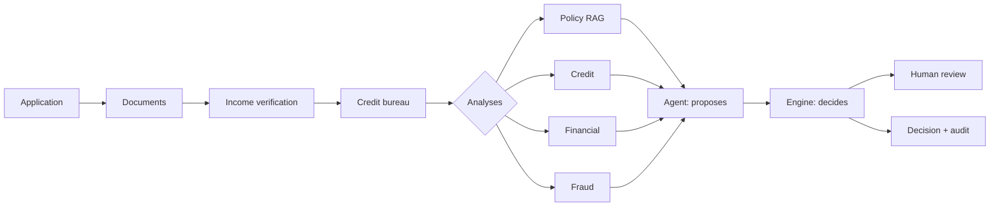

# Agentic Credit Underwriter

**FDE Academy capstone · Enterprise Agentic AI Engineering: From Business Workflow to Production**

An AI-assisted underwriting platform for a (fictional) digital lender, built
across nine lessons from business requirements to a production deployment.
Students finish with a deployable enterprise AI system and a portfolio
repository they can demo in interviews.

> Status: see the [course map](lessons/README.md). Everything runs offline by default:
> a deterministic mock LLM stands in for a real model until you set `LLM_MODE=live`.

## The business problem

Meridian Digital Lending's underwriters spend ~45 minutes per application
re-keying documents, calculating DTI and searching a 40-page policy. The platform
assembles a verified, evidence-backed case, proposes a recommendation, applies
policy deterministically, and escalates what needs a human, with a complete
audit trail. [Requirements →](architecture/requirements.md)

## Architecture



Two rules shape everything:

1. **AI only where it earns its place.** Interpretation and judgement go to LLMs;
   arithmetic, thresholds and validation stay in code. ([ADR-0001](architecture/adr/0001-hybrid-ai-deterministic.md))
2. **The agent proposes; the engine decides.** The agent may escalate, never relax
   policy. ([ADR-0002](architecture/adr/0002-agent-proposes-engine-decides.md))

[Full architecture →](architecture/README.md)

## Quick start

Requires Python 3.11+ and [uv](https://docs.astral.sh/uv/).

```bash
uv sync --all-groups
uv run pytest
uv run underwriter run-all
uv run underwriter run data/applications/APP-003.json
```

```text
Application  Expected       Actual         Reasons
APP-001      APPROVE        APPROVE        ok   MEETS_ALL_CRITERIA
APP-002      MANUAL_REVIEW  MANUAL_REVIEW  ok   DTI_ABOVE_REVIEW_THRESHOLD
APP-003      MANUAL_REVIEW  MANUAL_REVIEW  ok   CREDIT_DATA_UNAVAILABLE
...
```

## Sample cases

Each synthetic application exercises one path through the system
(`data/expected_outcomes.json`):

| Case | Scenario | Outcome |
|---|---|---|
| APP-001 | Clean, well-qualified | APPROVE |
| APP-002 | Post-loan DTI ~46% | MANUAL_REVIEW |
| APP-003 | No bureau record: score must not be invented | MANUAL_REVIEW |
| APP-004 | Stated income 43% above payslip | MANUAL_REVIEW |
| APP-005 | Score 561, four delinquencies | DECLINE |
| APP-006 | Payslip name ≠ applicant | MANUAL_REVIEW |
| APP-007 | Self-employed, no tax return | MANUAL_REVIEW |
| APP-008 | Agent approves at 43.9% DTI; engine overrides | MANUAL_REVIEW |

All people, employers and the lender are fictional.

## Repository layout

```text
architecture/      requirements, diagrams, ADRs, failure modes
CLAUDE.md          rules and commands for Claude Code (lesson 0)
.claude/           settings, lint hook, /plan-lesson /verify /review, course skills
lessons/           one folder per lesson: guide, exercises, slides link
src/underwriter/
  domain/          typed contracts (Pydantic)
  workflow/        service contracts, lesson implementations, orchestrator
  decision/        policy thresholds + deterministic decision engine
  risk/            exact financial calculations
  ingestion/       document loading and extraction
  tools/           external systems (credit bureau, ...)
  rag/             parsing, chunking, hybrid retrieval, policy analyzer (L2)
  evaluation/      retrieval eval (L2)
  llm/             LLM port, mock, LiteLLM adapter, config (L3)
  agents/          context, prompt, validation, LLM underwriting agent (L3)
  api/             built in a later lesson
data/              applications, documents, bureau records, lending policy
  corpus/          10 US federal documents + manifest (L2)
evals/             retrieval cases (L2), golden cases, gates, baseline (L6)
scripts/           sample data generator
tests/             unit, contract and end-to-end tests
.github/workflows/ci.yml   CI (GitHub Actions): lint, tests, run-all on every push
```

## Technology

Python · Pydantic · pytest · uv · pypdf · Beautiful Soup · LangGraph · OpenTelemetry · LiteLLM (optional, any provider) · CI on GitHub Actions.

## Known limitations

- The default embedder is a deterministic hashing model (spelling overlap, not meaning); a real embedding model plugs in through the same port.
- Document extraction is regex over clean synthetic files (LLM extraction: lesson 3).
- The default LLM is a deterministic mock; set `LLM_MODE=live` and `LLM_MODEL` for a real provider.
- Checks and analyses run sequentially (concurrency: lesson 8).
- Review checkpoints are in memory: a paused review lives as long as the process (a durable checkpointer plugs in through `build_graph(checkpointer=…)`).
