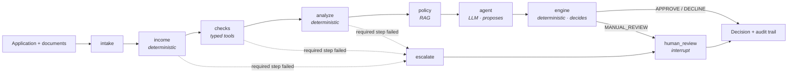

# ARCHITECTURE.md: agentic-credit-underwriter

The one-page architecture of the Agentic Credit Underwriting Platform. It is the first
thing an engineer or Claude reads after `CLAUDE.md`. The detail lives in
[`architecture/`](architecture/): requirements, ADRs and failure modes. This page ties
them together and links to them rather than repeating them.

> This file follows the shape of `ARCHITECTURE.template.md` in
> `claude-project-template`. A new project fills in the same sections.

## 1. Problem and outcome

Meridian Digital Lending makes unsecured personal loans ($1k–$50k) online. An
underwriter spends about 45 minutes per application gathering facts. **Outcome:** the
system gathers and checks the facts, an agent proposes a recommendation with citations,
a deterministic engine decides, and anything uncertain goes to a human. Every decision is
reproducible from its audit trail. See [requirements.md](architecture/requirements.md).

| Who | What they need from the system |
|---|---|
| Applicant | A fair, explainable decision; never declined by a model alone |
| Underwriter (human reviewer) | Escalated cases with the facts, the proposal and the reasons |
| Risk and compliance | Policy applied exactly; every step auditable; no personal data leaked to vendors |
| Operations | Cost and latency per decision; release gates that catch regressions |

## 2. Non-negotiables (the invariants)

These are the rules in `CLAUDE.md`. Each one is enforced in code and checked by a test
or an eval invariant, not left to the prompt.

| # | Invariant | Enforced by | Checked by |
|---|---|---|---|
| I1 | The agent proposes; the engine decides | `decision/engine.py` is the only writer of a recommendation | eval invariants `UNSAFE_APPROVAL`, `UNFAIR_DECLINE` |
| I2 | Escalate, never guess | reason codes plus MANUAL_REVIEW for missing or conflicting data | APP-003, APP-007; golden cases |
| I3 | Typed results at every boundary | `CheckResult`, `NodeRun`, `AgentRecommendation(valid=…)` | tool and fault tests |
| I4 | Provider-agnostic | only `llm/` imports a model SDK | the `LLMClient` port; the mock |
| I5 | Fault injection is a feature, never in production | `FaultPlan`, `NodeFaults`, mock LLM faults; refused when `APP_ENV=production` | fault tests |
| I6 | Everything is audited, append-only | `AuditEvent`; `operator.add` on graph state | audit tests; eval invariant "starts at intake" |
| I7 | No personal data in prompts, messages or traces | `agents/context.py` minimisation; span redaction | PII tests over every sample |

## 3. System view



The graph is `workflow/graph.py` (lesson 5). The components it calls are owned by
`workflow/orchestrator.py`, so each one can be tested on its own.

## 4. Components: where AI earns its place

The rule ([ADR-0001](architecture/adr/0001-hybrid-ai-deterministic.md)): use a model
only where the input is unstructured or the work is judgement and explanation. Anything
with an exact answer is code.

| Component | Kind | Module | Why this kind |
|---|---|---|---|
| Document parsing | Deterministic (AI in a later version) | `ingestion/documents.py` | Fixtures are structured; real ones would need extraction |
| Income verification | Deterministic | `workflow/services.py` | Policy §5 gives exact rules |
| External checks (bureau, fraud, bank, employment) | Typed tools, run concurrently with retries (L8) | `tools/checks.py`, `reliability/` | Systems of record; never estimated |
| Risk metrics (DTI, payment, LTI) | Deterministic | `risk/calculations.py` | Arithmetic must be exact and unit-tested |
| Policy and regulation retrieval | **AI: RAG** (BM25 + vectors + RRF) | `rag/` | Long prose; reviewers need citations |
| Underwriting agent | **AI: LLM**, bounded tool loop | `agents/` | Weighs evidence, explains, flags gaps |
| Decision engine | Deterministic | `decision/engine.py`, `policy.py` | Policy applied exactly; may override the agent |
| Human review | Human, via `interrupt()` | `workflow/graph.py` | Required by policy §8–9 |
| Evaluation | Deterministic harness | `evaluation/`, `evals/` | Release gates |
| Observability | OpenTelemetry spans and usage | `observability/`, `llm/instrumented.py` | Cost, latency and "why" per decision |

## 5. The trust model: four layers between the model and a decision

1. **Input: minimise and identify** (`agents/context.py`). The model sees no names,
   ID digits, emails, dates of birth or addresses. Every fact has an id it must cite.
   Policy excerpts are cut first when the budget runs out; signals and metrics never are.
2. **Output: validate, repair once, fail safe** (`agents/validation.py`). Schema, then
   semantics: cited ids exist, figures match the facts, percentages match a fact. One
   repair turn, then `INVALID_MODEL_OUTPUT` and MANUAL_REVIEW.
3. **Action: bound the agent** (`agents/tool_agent.py`, `agents/tools.py`). An allow-list
   of read-only tools, a tool-call cap, a deadline from an injected clock, then
   `AGENT_LIMIT_REACHED`. No tool decides, approves or writes.
4. **Decision: the engine and a human** (`decision/engine.py`). The engine applies policy
   and records `overridden_by_policy`. An agent may escalate; it may never decline on its
   own or relax policy ([ADR-0002](architecture/adr/0002-agent-proposes-engine-decides.md)).
   MANUAL_REVIEW always reaches the review queue.

## 6. Boundaries and contracts

| Boundary | Contract | Failure shape |
|---|---|---|
| Ingestion → system | `LoanApplication`, `Document` (pydantic) | validation error at the edge |
| System → external check | `CheckSpec` → `CheckResult(status, reason, data)` | `OK` / `UNAVAILABLE` / `INVALID` with a reason, never `None` |
| System → model | `LLMClient.complete(messages) -> LLMResponse` | `LLMUnavailable`; never retried |
| Model → system | `UnderwritingOutput` (`extra="forbid"`) | `ValueError` with a message the repair turn can use |
| Agent → engine | `AgentRecommendation(valid, failure, evidence, …)` | `valid=False` plus a reason code |
| Workflow node | `run_node(policy) -> NodeRun` | `NodeFailed` → escalate / degrade / fallback |
| Engine → caller | `UnderwritingDecision(recommendation, reason_codes, audit_trail, usage)` | MANUAL_REVIEW plus reason codes |

**Dependency direction** (enforced by review; imports point down only):

```text
cli, evaluation
   └── workflow (graph, orchestrator, resilience, services)
         └── agents ──┬── llm (port, adapters, mock)
                      └── rag
         └── tools, decision, risk, ingestion
               └── domain (models, reason codes)        observability: used by all, imports none
```

## 7. Control flow and resilience

Per-node policies (`NODE_POLICIES`) decide what failure means for each step:

| Node | On failure | Why |
|---|---|---|
| income, checks, analyze, engine | **escalate** → `WORKFLOW_ERROR` → human | No decision without them |
| policy (retrieval) | **degrade**: no citations, logged | Thresholds never depended on retrieval (F8) |
| agent | **fallback**: invalid proposal → MANUAL_REVIEW | A failed model is not evidence |

Only timeouts and `TransientNodeError` are retried; a bug fails on its first attempt.
Inside the checks node (lesson 8) the four checks run concurrently under one 3 s deadline;
each retries timeouts, 429s and 500s with full-jitter backoff (`Retry-After` as a floor),
and a check that misses the deadline is `UNAVAILABLE`, so the lesson 4 rules apply.
Human review pauses the graph with `interrupt()` and resumes from a checkpoint whose
serializer allows only the domain types.

## 8. Failure model

Seventeen failure modes, F1–F17, each with a designed response and a sample case or test:
[failure-modes.md](architecture/failure-modes.md). Every one can be injected
(`--tool-fault`, `--llm-fault`, `--node-fault`), so the response is tested and not just
hoped for. Rule of thumb: for every component, ask what happens when it returns nothing,
returns garbage, or never returns. If the answer is "it guesses", the design is wrong.

## 9. Data and sources of truth

| Truth | Where | Who may change it |
|---|---|---|
| Policy thresholds | `decision/policy.py` (from `data/policies/`) | The business, never tuning |
| Regulation | `data/corpus/` (real US federal documents, checksummed) | Nobody; fetched by script |
| Expected outcomes | `data/expected_outcomes.json`, `evals/golden_cases.json` | From reading policy, never from running the system |
| Sample applications | `data/applications/`, `data/documents/`, `data/bureau/` | Fictional; no real personal data |

## 10. Evaluation and release gates

Three layers, from specific to general (`evaluation/harness.py`, lesson 6):

- **Expectations** per golden case.
- **Invariants** on every case.
- **Gates** on the run: pass rate, zero unsafe approvals, zero unfair declines, p95
  latency, mean input tokens, and growth against `evals/baseline.json`.

Retrieval has its own eval (`eval-retrieval`). A change ships only when `ruff`,
`pytest`, `run-all` (8/8) and `eval` (32/32, every gate) are green.

## 11. Observability

One root span per decision, with child spans for nodes, checks, retrieval, LLM calls and
tool calls. They carry GenAI token attributes. Free-text attributes are redacted (I7).
Every decision carries `usage` (tokens, cost, step times). `underwriter trace` prints the
tree. Prices in `observability/metering.py` are placeholders.

## 12. Out of scope

Multi-tenancy and row-level security, database migrations, idempotency keys, message
queues, rate-limit and quota billing, streaming and cancellation, and any UI. These are
real production concerns that this course leaves out on purpose. See `CLAUDE.md` § Scope.

## 13. Decisions

| ADR | Decision |
|---|---|
| [0001](architecture/adr/0001-hybrid-ai-deterministic.md) | Hybrid system: AI only where it earns its place |
| [0002](architecture/adr/0002-agent-proposes-engine-decides.md) | The agent proposes; the engine decides |
| [0003](architecture/adr/0003-escalate-never-guess.md) | Missing or conflicting data escalates; nothing is guessed |

## 14. How this repo is built: spec-driven, milestone by milestone

The code was built with Claude Code from files an architect fixed first. Each milestone
(a lesson) has the same three files, and the kit can reproduce any starting point:

| File | Role |
|---|---|
| `CLAUDE.md` | Context, scope, plan, rules, clarifications, learnings from PRs |
| `ARCHITECTURE.md` + `architecture/` | This page, requirements, ADRs, failure modes |
| `lessons/NN-*/SPEC.md` | What to build: modules, public API (generated), behaviour, exact messages |
| `lessons/NN-*/PROMPTS.md` | How to build it with Claude: XML-tagged prompts, one module per step |
| `.claude/skills/`, `.claude/commands/` | Process skills (karpathy, Superpowers-adapted), use-case skills, repeated commands |
| `workflows/` | The same procedures written for people |

Proof: six headless Claude Code runs rebuilt lessons 1–6 from these files alone, with
every test green and the eval at 32/32. The reusable form of this method is the
`claude-project-template` repo.
