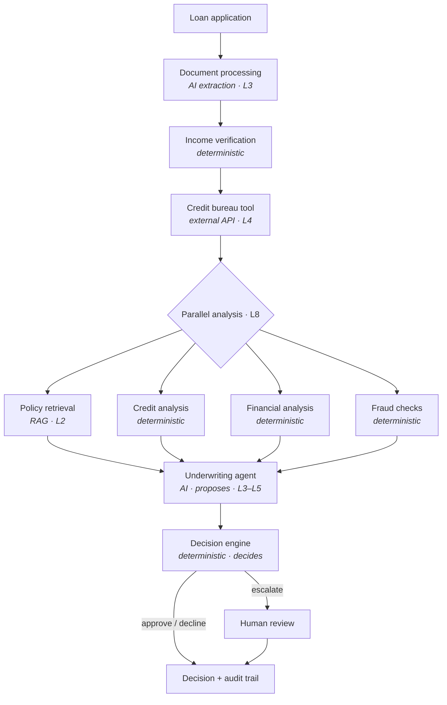

# Architecture

Lesson 1 deliverable: the architecture of the Agentic Credit Underwriting
Platform, derived from the business workflow in [requirements.md](requirements.md).

## System view

## Components

| Component | Responsibility | Implemented by | Why |
|---|---|---|---|
| Document processing | Turn payslips, statements, tax returns into typed facts | **AI** (L3); regex stub in L1 | Real documents are messy and varied |
| Income verification | Pick verified income per policy §5, compare to stated | Deterministic | A rule with exact thresholds |
| Credit bureau | Fetch the credit report | External API tool (L4) | System of record; never estimated |
| Policy retrieval | Find and cite the policy sections that apply | **AI / RAG** (L2) | Policy is long prose; reviewers need citations |
| Credit / financial / fraud analysis | Compute DTI, score bands, delinquencies, identity checks | Deterministic | Arithmetic and comparisons must be exact |
| Underwriting agent | Weigh the evidence, explain, flag missing info, propose | **AI** (L3–L5); rules stub in L1 | Judgement and explanation over many inputs |
| Decision engine | Apply policy; reconcile with the agent's proposal | Deterministic | The agent may escalate, never relax policy ([ADR-0002](adr/0002-agent-proposes-engine-decides.md)) |
| Human review | Resolve escalated cases | Human, via queue | Required by policy §8–9 |
| Audit trail | Record every step, actor and input | Deterministic | Policy §9.3: decisions must be reproducible |

## Code map

| Concept | Code |
|---|---|
| Typed contracts at every boundary | `src/underwriter/domain/models.py` |
| Service boundaries | `src/underwriter/workflow/contracts.py` |
| Lesson 1 implementations | `src/underwriter/workflow/services.py` |
| Components and entry points (`run`, `start`, `resume`) | `src/underwriter/workflow/orchestrator.py` |
| Workflow graph: typed state, edges, human review (L5) | `src/underwriter/workflow/graph.py` |
| Per-node timeout, retry, failure mode (L5) | `src/underwriter/workflow/resilience.py` |
| Eval harness, invariants, gates (L6) | `src/underwriter/evaluation/harness.py`, `evals/` |
| Tracing, usage metering, LLM instrumentation (L7) | `src/underwriter/observability/`, `llm/instrumented.py` |
| Retries with full jitter, concurrent checks under a deadline (L8) | `src/underwriter/reliability/` |
| Policy thresholds and engine | `src/underwriter/decision/` |
| Exact calculations | `src/underwriter/risk/calculations.py` |
| External checks as typed tools, fault injection (L4) | `src/underwriter/tools/checks.py`, `tools/faults.py` |
| Policy retrieval (L2) | `src/underwriter/rag/` |
| LLM port and adapters (L3) | `src/underwriter/llm/` |
| LLM underwriting agent (L3) | `src/underwriter/agents/underwriting.py` |
| Bounded tool-calling agent and its allow-list (L4) | `src/underwriter/agents/tool_agent.py`, `agents/tools.py` |

## Decisions

- [ADR-0001](adr/0001-hybrid-ai-deterministic.md) — Hybrid system: AI only where it earns its place
- [ADR-0002](adr/0002-agent-proposes-engine-decides.md) — The agent proposes; the engine decides
- [ADR-0003](adr/0003-escalate-never-guess.md) — Missing or conflicting data escalates; nothing is guessed

See also [failure-modes.md](failure-modes.md).
